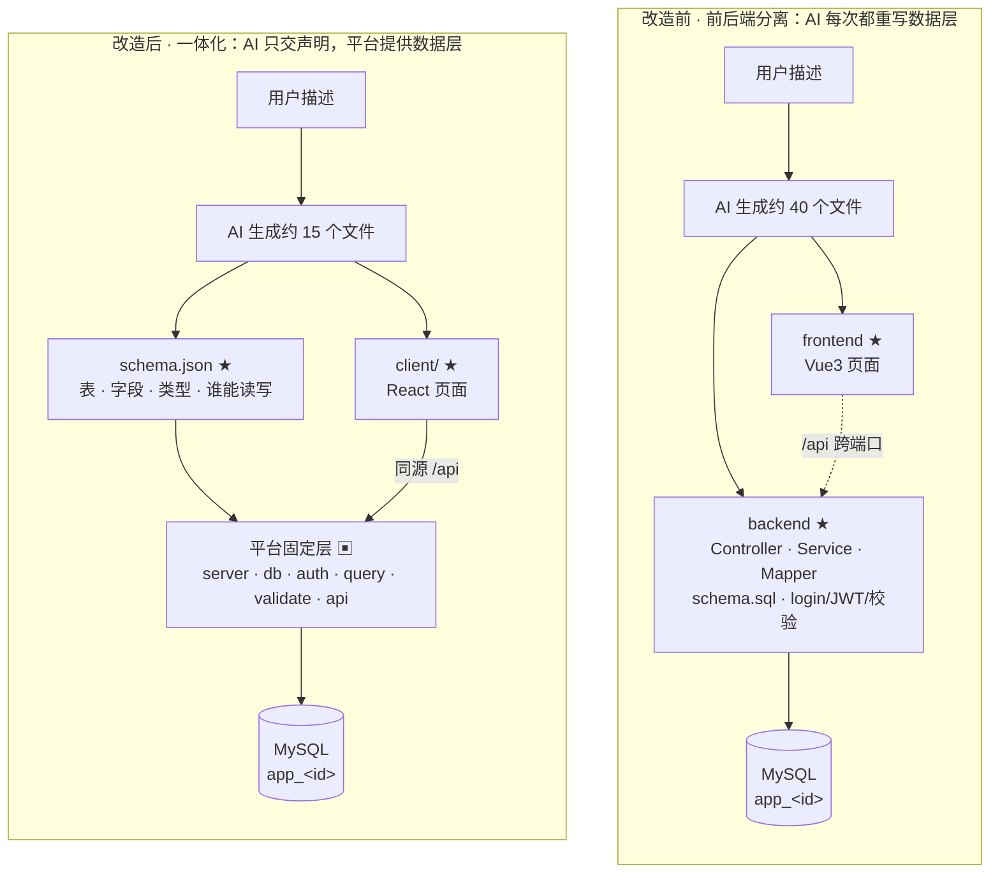
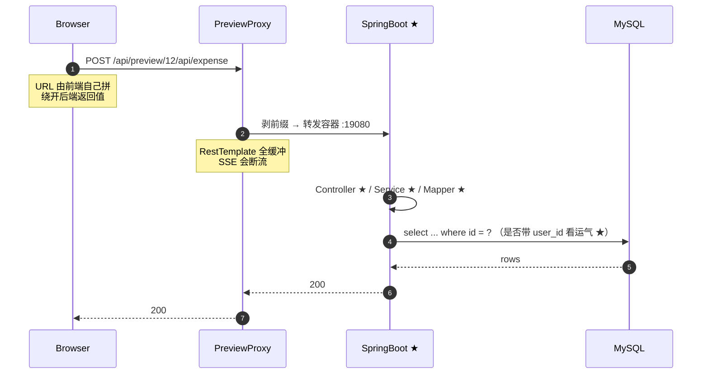
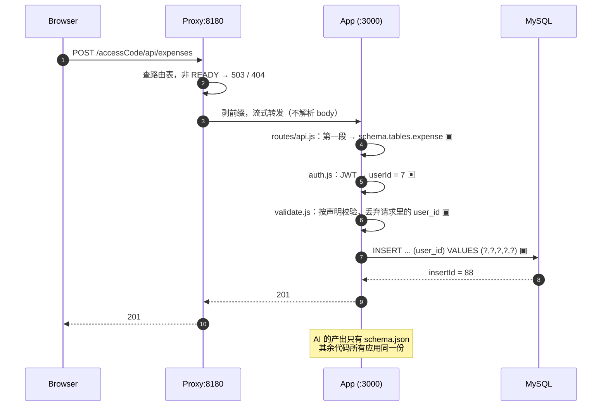
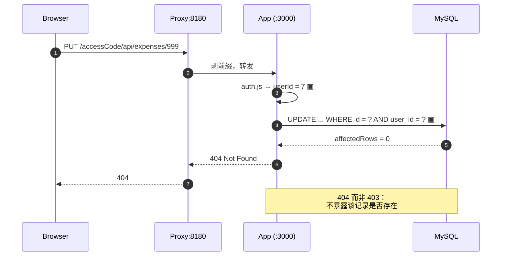

# 改造对照图与时序图

> 对照基准：**改造前 = 当前仓库这一版（Vue3 + Spring Boot 前后端分离）**，改造后 = 一体化单端口 + 平台固定数据层（0 号方案）。
> 配套文档：`docs/design/LOWCODE-APP-DESIGN.md`（方案本体）、`docs/design/代码生成一体化-改造思路.md`（改造面拆解）。

---

## 1. 一张表看清职责迁移

★ = AI 每次生成；▣ = 平台固定代码（写一次，所有应用共用）。

| 职责 | 改造前（前端分离 + Spring Boot） | 改造后（Node 一体化 + 平台数据层） |
|---|---|---|
| 数据模型 | ★ Java 实体 + MyBatis Mapper + `schema.sql` | ★ `schema.json`（约 30 行声明） |
| 建表 / 改表 | ★ AI 写原生 DDL | ▣ `lib/ddl.js` + `migrate.js` 由声明推导 |
| 拼 SQL / 防注入 | ★ Mapper 内字符串拼接 | ▣ `lib/query.js` 全占位符 + 列名白名单 |
| 归属（越权） | ★ 每个写接口手写 `user_id` 条件 | ▣ `scope()` 无条件注入 |
| 登录 / JWT / 密码哈希 | ★ 每应用重新实现一遍 | ▣ `auth.js` 一份实现 |
| 参数校验 / 分页上限 | ★ 每应用重新实现一遍 | ▣ `lib/validate.js` 按声明自动校验 |
| 依赖 / 构建 | ★ AI 自写 `pom.xml` / `package.json` | ▣ 锁版本 + 锁文件，可预热 |
| **页面 / 交互** | ★ AI | ★ AI（不变，这才是差异化部分） |
| 端口 / 进程 | 双端口 + 内存态进程句柄 | 单端口 + `docker exec -d`（属容器） |
| 访问入口 | 主服务反代 `/api/preview/{appId}/` | 独立 proxy + `accessCode` 短链 |
| AI 产出规模 | 约 40 个文件 / 数千行 | 约 15 个文件 / 声明 + 前端 |

---

## 2. 产物结构对照

```
改造前                                   改造后
┌──────────────────────────────┐         ┌──────────────────────────────┐
│ fullstack_{appId}/           │         │ fullstack_{appId}/           │
│ ├ backend/          ★ 全部   │         │ ├ schema.json        ★       │
│ │ ├ Controller      ★        │         │ ├ client/            ★       │
│ │ ├ Service         ★        │         │ ├ routes/                    │
│ │ ├ Mapper + SQL    ★        │         │ │ └ custom.js        ★ 可选  │
│ │ ├ schema.sql      ★        │         │ ├ server.js          ▣       │
│ │ └ *-sandbox.yml   ★        │         │ ├ config.js          ▣       │
│ ├ frontend/         ★ 全部   │         │ ├ db.js              ▣       │
│ │ ├ src/            ★        │         │ ├ auth.js            ▣       │
│ │ └ vite.config.js  ★        │         │ ├ migrate.js         ▣       │
│ └ README.md         ★        │         │ ├ lib/                       │
│                              │         │ │ ├ ddl.js           ▣       │
│  两个工程 / 两个端口          │         │ │ ├ query.js         ▣       │
│  两套配置 / 两次构建          │         │ │ ├ validate.js      ▣       │
│                              │         │ │ └ errors.js        ▣       │
│                              │         │ ├ routes/api.js       ▣       │
│                              │         │ ├ package.json + lock ▣       │
│                              │         │ └ public/dist/      （构建）  │
│                              │         │  一个工程 / 一个端口 / 一次构建│
└──────────────────────────────┘         └──────────────────────────────┘
```

---

## 3. 对照图（Mermaid）



---

## 4. 时序图 · 改造前（一次写操作）



---

## 5. 时序图 · 改造后（一次写操作）



---

## 6. 时序图 · 改造后（越权尝试）



---

## 7. 热路径归属（一行看懂差异）

```
改造前：Browser ──★── PreviewProxy ──★── Controller ──★── SQL ──▶ MySQL
                  （每一步都是本次 AI 生成的代码）

改造后：Browser ──▣── Proxy ──▣── routes/api ──▣── query ──▣──▶ MySQL
                                     ▲
                          schema.json ★（AI 只交这一份声明）
```

---

## 8. 读图结论

1. **外壳变化（单端口、短链、独立代理）不是本质**；本质是"热路径上的代码作者"从 AI 变成了平台。
2. 改造前，AI 的代码出现在热路径的**每一步**，任一步漏判归属就是一次越权。
3. 改造后，AI 的产出只在**数据模型这一处**被平台代码解释执行；越权在结构上被消掉，而不是靠提示词祈祷。
4. AI 的工作没有消失，而是收敛到真正差异化的部分：**数据模型 + 界面**。
