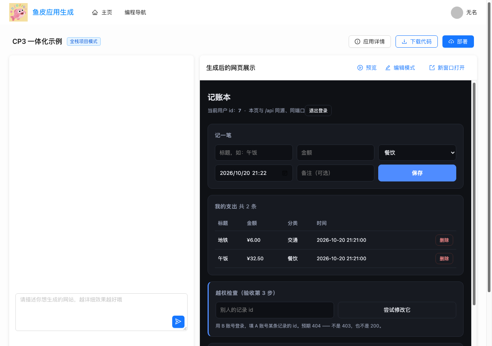
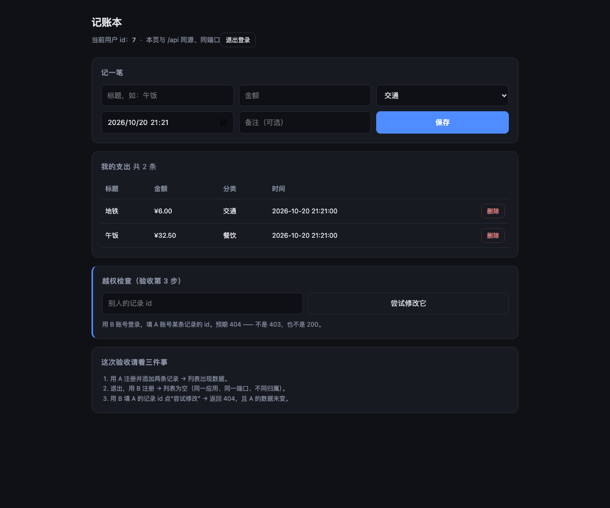

# CP3 验收报告 · 平台接线（从 UI 触发预览）

> 时间：2026-10-20 21:22（Asia/Shanghai）
> 范围：Phase 0 / CP3 —— **Java 侧接线 + 浏览器端到端实测**
> 结论：**接口层 7/7 通过；补做浏览器实测后又修掉 2 个"接口全绿、页面全挂"的问题，现已通过**
>
> - 平台 UI：<http://localhost:5173>（`cp3tester` / `12345678` → 打开「CP3 一体化示例」→ 点「预览」）
> - 直接预览：<http://localhost:8123/api/preview/451590758596771841/>



---

## 一、首次验收的漏洞：接口对了，页面不对

第一轮只跑了 curl：页面 200、JS 资源 200、16 条数据层断言全过。**但用户打开 UI 看到的不是这个结果。** 补做 headless 浏览器实测后，暴露两个独立问题：

### 问题 1：种子应用没有「预览」入口

页面里预览只在一处被触发 —— 打开应用时若对话历史 ≥2 条才自动调用 `updatePreview()`。
种子应用没有对话，于是右侧永远是「生成后的网页展示」占位，没有任何按钮可点。

**修法**：在预览区头部加一个「预览」按钮（仅全栈项目、仅作者可见），带 loading 状态，手动触发 `updatePreview()`。

### 问题 2：应用内 API 用了绝对 `/api`，全部打到平台后端

React 里写的是 `fetch('/api/expenses')`。在预览路径 `/api/preview/{id}/` 下，这个绝对路径解析成 `http://localhost:8123/api/expenses` —— 命中**平台**后端，返回 404。表现：页面能开、点登录/注册/保存全部失败。

浏览器网络日志（修复前）：

```
200 /api/preview/{id}/
200 /api/preview/{id}/assets/index-B_Ga5OvU.js
404 /api/auth/register          ← 少了前缀，打到平台
```

**修法**：API 基址由**当前文档路径**推导，而不是写死：

```js
export function resolveApiBase() {
  const p = window.location.pathname;
  const dir = p.endsWith('/') ? p : p.slice(0, p.lastIndexOf('/') + 1);
  return `${dir}api`;        // / → /api；/api/preview/1/ → /api/preview/1/api
}
```

修复后：

```
201 /api/preview/{id}/api/auth/register
200 /api/preview/{id}/api/expenses?sort=-spent_at&pageSize=50
```

### 为什么 curl 没抓到？

因为 curl 是**按正确路径**去请求的（`$BASE/api/expenses`，`$BASE` 已经带前缀），而页面里的 JS 自己拼了另一条路径。**这类问题只有真实浏览器能发现。**

所以补了一个可复用的脚本：`scripts/dev/ui-smoke.mjs`（CDP 驱动 headless Edge，走完「平台登录 → 点预览 → 应用内注册 → 记账」并截图），把它作为相对路径类回归的守门人。

---

## 二、修复后的自动验收

`bash scripts/verify-cp3.sh <appId>`：

```text
[✅] 平台登录成功（cp3tester）
[✅] preview 接口返回预览地址
[✅] 页面 GET / → 200 且是 HTML
[✅] JS 资源经代理 → 200 且 content-type 是 JS（不是 SPA 兜底的 HTML）
[✅] CP1 数据层 16 条断言全部通过（经代理）
[✅] 容器内恰有 1 个应用进程、且无僵尸进程
[✅] 端口只绑 127.0.0.1，不暴露到局域网
== 7 通过 / 0 失败 ==
```

`node scripts/dev/ui-smoke.mjs <appId>`：

```text
1) 平台登录
   ok, userId = 470140994046812160
2) 打开应用并点预览
   iframe = http://localhost:8123/api/preview/451590758596771841/
3) 在应用内注册并记一笔
4) 结果
   记账成功: true
   应用侧无 4xx/5xx
```



---

## 三、其余关键证据

| 项 | 结果 |
|---|---|
| 端口映射 | `3000→127.0.0.1:20921`、`8080→127.0.0.1:18921`、`8081→127.0.0.1:19921` |
| 容器进程 | `PID 1 node /app/app.js`（文件服务）、`PID 9 node server.js`（应用）、无僵尸 |
| 数据隔离 | 库 `app_451590758596771841` + 同名账号，只 `GRANT` 本库 |
| 主服务重启 | 重启后直接访问预览地址仍 **200**，**未重新触发 preview** |
| 请求体注入 | `user_id=999999` 被丢弃，落库归属为当前用户 |
| 越权 | B 改 A 的记录 → 404，经代理未被吞成 502 |

---

## 四、交付物

新增：

| 路径 | 说明 |
|---|---|
| `sandbox/SandboxAppLauncher.java` | 一体化启动器：双通道探活、`exec -d` 兜底、8s 静默等待避免重复启动、缺 DB env 时明确报错 |
| `scripts/verify-cp3.sh` | 平台登录 → 预览 → 页面/资源/数据层/进程端口 共 7 条 |
| `scripts/dev/ui-smoke.mjs` | 真实浏览器冒烟（CDP），抓"接口绿、页面挂"类问题 |

修改：

| 路径 | 改动 |
|---|---|
| `SandboxProperties` | `appContainerPort=3000`、`appPortRangeStart=20080`、`bindAddress=127.0.0.1` |
| `SandboxContainerManager` | 三端口只绑本机；建库**建独立账号**；容器级 env；暴露 `containerNameOf/toolHostPort/appHostPort/appBaseUrl` |
| `PreviewService` | 根目录有 `server.js` → 走新启动器 |
| `PreviewProxyController` | 整体透传；`resolveRestPath` 改用 RequestURI；4xx 不再变 502 |
| `AppController` | 返回 `code.preview-base` |
| `AppChatPage.vue` | 用后端返回值；**新增「预览」按钮** |
| `samples/expense/client/src/api.js` | **API 基址改为按文档路径推导** |
| `application.yml` | 沙箱应用端口、绑定地址、`code.preview-base` |

---

## 五、这一轮修掉的 5 个问题

| # | 问题 | 现象 | 根因 | 修法 |
|---|---|---|---|---|
| 1 | 没有预览入口 | 打开应用右侧只有占位 | 只在"对话≥2条"时自动预览 | 加「预览」按钮 |
| 2 | **绝对 `/api`** | 页面能开、接口全 404 | 应用内 `fetch('/api')` 在带前缀的路径下打到平台 | 按 `location.pathname` 推导 base |
| 3 | 路径属性失效 | 经代理取 JS 返回 HTML | Spring Boot 3 `PathPatternParser` 下 `PATH_WITHIN_HANDLER_MAPPING_ATTRIBUTE` 不可靠 | 用 `RequestURI` 剥前缀 |
| 4 | 重复启动 | 僵尸进程 + 端口冲突 | `start.sh` 已拉起，launcher 又 exec 一次 | 先等 8s 再兜底 |
| 5 | 4xx 变 502 | 越权返回 502 | `RestTemplate` 默认对 4xx 抛异常 | 透传专用 handler |

---

## 六、已知限制

1. 代理仍在主服务里（`RestTemplate` 缓冲），**SSE 会断流** —— CP4 独立 proxy 解决。
2. 端口仍按 `appId % 1000` 取模，每应用发布 3 个宿主端口（8081 为旧格式占位）。
3. **预览地址无鉴权**，知道 URL 就能访问 —— accessCode 短链要解决。
4. 旧格式项目仍走原路径。
5. **本轮生成链路不可用**：后端以 `mvn spring-boot:run` 启动时没有加载 `.env`，`LLM_API_KEY` 是占位值，触发生成会 401。本次验收用"种子应用 + 已有产物"验证预览，与生成解耦。
6. 平台运行方式：后端 8123（`/tmp/backend.log`）、前端 5173（`/tmp/frontend.log`）。

---

## 七、下一步（CP4）

1. `proxy/` 模块（WebFlux）+ `/{accessCode}/**` 剥前缀**流式**反代。
2. `app_access_route` 路由表，主服务写、proxy 只读。
3. `accessCode` 复用 `deployKey`，预览/部署同一链接。
4. 端口不再发布（proxy 走容器网络）或随机端口回读。
5. 验收：经 proxy 访问、两个 accessCode 指向不同容器、SSE 不断流。
