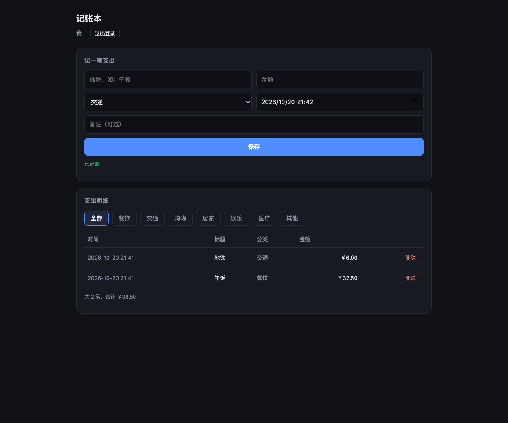

# CP4 验收报告 · 生成侧接线（AI 只产声明 + 前端）

> 时间：2026-10-20 21:42（Asia/Shanghai）
> 范围：Phase 0 / P0 —— **让 AI 真正产出新形态应用：schema.json + React 页面，后端由平台模板提供**
> 结论：**跑通了一次完整的「一句话 → 生成 → 构建 → 预览 → 记账」，且数据层 16/16 断言全过**
> 生成应用：<http://localhost:8123/api/preview/451590758596771845/>
> 生成耗时：约 40 秒（含 npm install 与构建）



---

## 一、这轮改了什么

| 面 | 改动 |
|---|---|
| **提示词** | `codegen-fullstack-system-prompt.txt` 从"写 Vue+SpringBoot 全栈工程"重写为"**只写 schema.json + client/src 页面**"，并附接口契约、登录契约（邮箱）、样式类名、违禁清单 |
| **模板注入** | 新增 `AppTemplateService`：生成任务开始时把 16 个平台文件（运行时 + 构建配置 + 前端骨架）写入项目 |
| **写入白名单** | `FileWriteTool` / `FileModifyTool` / `FileDeleteTool` 命中平台路径直接拒绝，并提示 AI 该写哪里 |
| **构建工具** | `BuildProjectTool` 增加一体化分支：**schema 校验 → 违禁扫描 → npm install → npm run build → node --check → 检查 dist**；旧项目分支保留 |
| **兜底构建** | `GenTaskExecutor` 在 AI 流结束后**自动再构建一次**（实测 AI 会跳过 build 直接 exit） |
| **工具轮次** | `maxSequentialToolsInvocations` 20 → 40 |
| **模型配置** | `.env` 统一 DeepSeek key，`deepseek-flash` + `reasoning-effort=low`；后端改为加载 `.env` 启动 |

---

## 二、生成结果

AI 产出的文件（14 个，全部在允许范围内）：

```
schema.json                  ← 数据声明
client/src/App.jsx           ← 页面入口
client/src/components/AuthForm.jsx
client/src/components/ExpenseBook.jsx
+ 平台注入的 16 个运行时文件（server/db/auth/lib/routes/client 骨架）
```

`schema.json` 摘要：

```json
{
  "auth": { "enabled": true },
  "tables": {
    "expenses": {
      "owner": true,
      "columns": {
        "title": {"type":"string","max":100,"required":true},
        "amount": {"type":"decimal","precision":[12,2],"min":0,"required":true},
        "category": {"type":"enum","values":["餐饮","交通","购物","居家","娱乐","医疗","教育","其他"]},
        "spent_at": {"type":"datetime","required":true},
        "note": {"type":"text","max":1000}
      }
    }
  }
}
```

数据层 16 条断言（打到生成应用的预览地址）：

```text
[✅] 请求体注入 user_id=999999 被丢弃，实际归属为 A(id=2)
[✅] B 的列表 total=0（数据隔离）
[✅] B 修改 A 的记录 → 404
[✅] 金额为负 → 400   [✅] 非法枚举 → 400
[✅] 未声明的表 → 404  [✅] 非法排序字段 → 400
== 16 通过 / 0 失败 ==
```

浏览器实测：注册 → 记两笔 → 列表显示「共 2 笔，合计 ￥38.50」+ 分类筛选 + 删除。

---

## 三、这一轮踩的 4 个坑

| # | 问题 | 现象 | 根因 | 修法 |
|---|---|---|---|---|
| 1 | 违禁扫描误报 | 连续 3 次构建失败："前端出现硬编码地址 /api/preview/" | 扫描把**平台文件 `api.js` 的注释**当成了业务代码 | 扫描跳过平台文件 |
| 2 | `env` 不在命令白名单 | 构建失败："命令不被允许: env" | 想用 `env -u http_proxy` 去掉镜像里烤死的代理，但沙箱白名单只有 npm/mvn/java/node/javac/sh/bash | 改成 `sh -c "unset http_proxy...; npm install"`，无需改镜像 |
| 3 | AI 跳过构建直接 exit | 任务"成功"但没有 `public/dist` | 提示词要求构建，AI 仍直接调 exit | 执行器在流结束后**兜底构建**，失败即任务失败 |
| 4 | 白名单被 `./` 绕过 | AI 写 `client/src/./api.js` 覆盖了平台文件 | `normalize()` 只去掉行首 `./` | 用 `Paths.normalize()` 折叠 `.` / `..` |

第 1 条最有代表性：**校验器把平台自己的文件也当成了业务代码**。修完之后同一 prompt 一次通过。

---

## 四、当前限制

1. **没有修复循环**：构建失败即任务失败，不会自动把错误回灌给 AI 重试（下一轮可加一轮 repair）。
2. **npm install 每次约 10 秒**（已用 npmmirror + 去代理），还没有做依赖预热。
3. **UI 质量参差**：这次生成用了平台样式类，效果尚可；prompt 只能约束到"可读"，不能保证美观。
4. **旧项目仍走旧链路**（frontend/ + backend/），两套并存。
5. **成本**：单次生成约 40s；`deepseek-flash` + low 已是最省配置。

---

## 五、下一步：P1（accessCode 短链 + 独立 proxy）

1. `proxy/` 模块（WebFlux）：`/{accessCode}/**` 剥前缀**流式**反代。
2. `app_access_route` 路由表：主服务写、proxy 只读。
3. `accessCode` 复用 `deployKey`，预览 / 部署同一链接。
4. 端口不再发布（proxy 走容器网络）或随机端口回读。
5. 验收：经 proxy 访问、两个 accessCode 指向不同容器、SSE 不断流。
